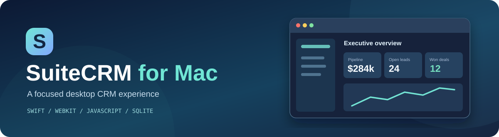

<p align="center"></p>

<h1 align="center">SuiteCRM for Mac</h1>
<p align="center"><b>Desktop-first CRM workflows, inspired by open-source SuiteCRM.</b></p>
<p align="center">A standalone Mac and browser CRM prototype made with Swift, WebKit, JavaScript and Python.</p>

<p align="center">
<a href="https://github.com/NerdNinjaAliaz/SuiteCRM-Mac/actions/workflows/build-macos-dmg.yml"></a>


</p>

<p align="center">
<a href="#-quick-start">Quick start</a> ·
<a href="#-features">Features</a> ·
<a href="#-build-a-dmg-installer">DMG installer</a> ·
<a href="docs/index.html">Project landing page</a> ·
<a href="mac-desktop/SUITECRM_MAC_DOCUMENTATION.md">Developer docs</a>
</p>

> [!IMPORTANT]
> **Unofficial independent prototype.** This is a **fork of [SuiteCRM/SuiteCRM](https://github.com/SuiteCRM/SuiteCRM)** with a separate Mac/browser companion inside [`mac-desktop/`](mac-desktop/). The companion is **not** a port of the upstream PHP/MySQL application, does **not** use the real PHP SugarBean ORM, and does **not** connect to or synchronize with a SuiteCRM server. Do not use it for sensitive production customer data.

## ✨ Features

| Workspace | Capabilities |
|:---|:---|
| 📊 **Dashboard** | KPIs, weighted pipeline forecasts, interactive charts and open activities |
| 🏢 **Accounts & Contacts** | Company and person records with related-record inspectors |
| 🎯 **Leads** | One-click lead conversion into Account, Contact and Opportunity |
| 📈 **Opportunities** | Six sales stages, Kanban/list views and probability automation |
| 🧾 **Quotes (AOS-inspired)** | Automatic subtotal, discount, tax and total calculations |
| 🛟 **Cases & Activities** | Support tickets, calls, meetings, tasks and escalation |
| ⚡ **Workflows** | Four sample before/after-save business rules |
| 🔎 **Search & theme** | `⌘K` Spotlight-style lookup and light/dark theme |

The UI comes with **fictional demo data**.

## 🚀 Quick start

Clone the repository's **`mac-version`** branch:

```bash
git clone --depth 1 --branch mac-version https://github.com/NerdNinjaAliaz/SuiteCRM-Mac.git
cd SuiteCRM-Mac
```

### 1 · Browser preview

```bash
bash mac-desktop/run_browser.sh
```

Or open `mac-desktop/suitecrm_mac.html` in a modern browser. No compilation required. **An internet connection is needed for full styling and charts**, which load Tailwind CSS, Chart.js and Google Fonts from CDNs.

### 2 · Native macOS app

Requires macOS and **Xcode Command Line Tools**:

```bash
xcode-select --install  # run only if not already installed
bash mac-desktop/run_mac.sh
```

This compiles and opens the `NSWindow` + `WKWebView` desktop shell. See [desktop README](mac-desktop/README.md) for troubleshooting and storage.

### 3 · Python + SQLite CLI (optional)

Requires **Python 3.10+**; no pip dependencies:

```bash
python3 mac-desktop/sugarbean_engine.py init
python3 mac-desktop/sugarbean_engine.py summary
python3 -m unittest discover -s mac-desktop -p 'test_suitecrm_mac.py' -v
```

**Important:** The Python SQLite datastore is independent of the browser and native app; they do not sync automatically.

## 📦 Build a DMG installer

Build a universal Apple Silicon + Intel installer on macOS 13+ with Xcode Command Line Tools:

```bash
bash mac-desktop/check_requirements.sh
bash mac-desktop/build_dmg.sh
open mac-desktop/dist
```

Output files:

- `mac-desktop/dist/SuiteCRM for Mac.app`
- `mac-desktop/dist/SuiteCRM-for-Mac-1.0.0.dmg`

**Without a Mac:** Use [Build macOS DMG Installer](https://github.com/NerdNinjaAliaz/SuiteCRM-Mac/actions/workflows/build-macos-dmg.yml) → **Run workflow** → `mac-version`. After a successful run, download the artifact ZIP and extract the DMG. The workflow does **not** publish a GitHub Release automatically.

> [!WARNING]
> This is an **ad-hoc-signed developer DMG**, not Apple-notarized. macOS Gatekeeper may warn on downloaded builds. For wider distribution, configure Apple Developer ID signing and notarization. See [DMG guide](mac-desktop/DMG_GUIDE.md).

## 🏗️ Architecture

```text
Swift NSWindow + WKWebView
        │ hosts
        ▼
suitecrm_mac.html ── JS BeanStore / Vardefs / workflow rules
        │
        ├── Browser mode → localStorage
        └── Native mode  → Application Support / beans.json

Separate command-line implementation:
sugarbean_engine.py → SQLite / crm.sqlite3
                  (NO live synchronization)
```

| Mode | Default data location |
|---|---|
| Browser | localStorage, per browser profile and origin |
| Native WebKit app | `~/Library/Application Support/SuiteCRM-for-Mac/beans.json` |
| Python engine | `~/Library/Application Support/SuiteCRM-for-Mac/crm.sqlite3` |

Export and back up your data before resets. **Excel, Word and PDF exports are not implemented**.

## 🗂️ Repository structure

```text
SuiteCRM-Mac/
├── modules/, include/, custom/, ...  # original SuiteCRM PHP project
├── LICENSE.txt                       # original AGPL-3.0 license
├── README.md                         # redesigned project landing page
├── docs/
│   ├── index.html                    # custom static project webpage
│   └── assets/project-banner.svg
├── mac-desktop/
│   ├── suitecrm_mac.html             # Mac-inspired CRM UI
│   ├── MacApp.swift                  # native WebKit wrapper
│   ├── sugarbean_engine.py           # separate SQLite engine
│   ├── test_suitecrm_mac.py          # Python tests
│   ├── run_browser.sh                # browser launch helper
│   ├── run_mac.sh                    # native build + launch
│   ├── check_requirements.sh         # macOS build preflight
│   ├── build_mac.sh                  # executable compiler
│   ├── build_dmg.sh                  # .app and .dmg packaging
│   ├── GenerateIcon.swift            # application icon generator
│   ├── DMG_GUIDE.md
│   └── SUITECRM_MAC_DOCUMENTATION.md
└── .github/workflows/               # tests and DMG builds
```

## 🧰 Developer notes & security

- Metadata-driven JavaScript fields are defined in `SUITECRM_VARDEFS`. They are **inspired by** PHP vardefs, not a parser for them.
- The Mac UI still requires network CDN assets for its complete appearance.
- This prototype does **not** provide production authentication, permissions, encryption, conflict resolution, cloud sync or hardened input validation.
- For internals and CLI details: [technical documentation](mac-desktop/SUITECRM_MAC_DOCUMENTATION.md). For distribution: [DMG documentation](mac-desktop/DMG_GUIDE.md).

## 🌐 Project description website

An independent, redesigned [landing page](docs/index.html) is included. To publish it using GitHub Pages (if available), use **Settings → Pages → Deploy from a branch → `mac-version` → `/docs` → Save**. It will not be publicly hosted until Pages is enabled.

## 🤝 Origin and license

The original upstream application is [SuiteCRM/SuiteCRM](https://github.com/SuiteCRM/SuiteCRM), released under **GNU AGPL-3.0**; see this fork's [LICENSE.txt](LICENSE.txt). Preserve its original notices and comply with the license when distributing modifications. This Mac companion is an **independent, unofficial experiment**, not endorsed by SuiteCRM.

<p align="center"><sub><a href="mac-desktop/README.md">Get started</a> · <a href="https://github.com/NerdNinjaAliaz/SuiteCRM-Mac/issues">Issues</a> · <a href="https://github.com/SuiteCRM/SuiteCRM">Upstream</a></sub></p>
